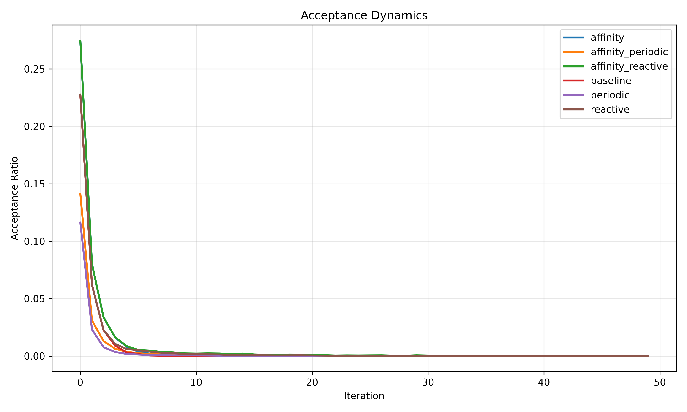

# BLOC-RELOC v2

**Experimental graph-partitioning engine and dynamics observatory.**  
**Motor experimental de particionado de grafos y observatorio de dinámicas de búsqueda.**

BLOC-RELOC v2 studies local partition moves, structural affinity, hub-dominated graphs and how search dynamics relate to graph-cut quality. This repository contains implementation code, generation scripts, experiment outputs, analysis tools and a **historical six-configuration observational synthesis**.

> **Research status:** The results below describe the recorded benchmark configurations; they are not a universal superiority claim. The final synthesis aggregates existing artifacts, **without rerunning experiments**. The repository's minimal runner currently compares **two variants**, not all four variants specified in the broader experimental plan.

## Start here / Empezar aquí

| Goal / Objetivo | Entry point |
| --- | --- |
| Understand the algorithm / Entender el algoritmo | [Core implementation](src/bloc_reloc_v2/core.py) |
| Generate synthetic graph fixtures / Generar grafos sintéticos | [Graph generators](src/bloc_reloc_v2/generators.py) · [generation runner](experiments/run_generation.py) |
| Run the baseline comparison / Ejecutar la comparación básica | [Experiment runner](experiments/run_experiment.py) |
| Inspect recorded results / Revisar resultados existentes | [Results CSV](results/bloc_reloc_v2_results.csv) · [observatory summary](results/observatory/executive_report/EXECUTIVE_SUMMARY.md) |
| Read the historical synthesis / Leer la síntesis histórica | [Final synthesis](results/observatory/final_synthesis/BLOC_RELOC_V2_FINAL_SYNTHESIS.md) |
| Reproduce without confusing old/new evidence / Reproducir sin mezclar evidencias | [Reproducibility guide](reproducibility/README.md) |
| Review scientific constraints / Revisar limitaciones | [Experimental plan](reproducibility/EXPERIMENT_PLAN.md) |

## What was observed / Qué se observó

The archived Dynamics Observatory synthesis reports the following **mean final edge-cut values** across six tested configurations (lower is better *within this suite*):

| Configuration | Recorded mean final edge cut |
| --- | ---: |
| affinity_periodic | 528.6583 |
| periodic | 536.6833 |
| affinity_reactive | 538.4083 |
| reactive | 540.0083 |
| affinity | 566.6583 |
| baseline | 583.2000 |

Source: [BLOC-RELOC v2 final synthesis](results/observatory/final_synthesis/BLOC_RELOC_V2_FINAL_SYNTHESIS.md). The observations cover **six configurations**, are exploratory, and do not establish causality or generalization to untested graph families.



*Archived experimental visualization / Visualización experimental archivada.*

## Minimal reproduction / Reproducción mínima

Run from the repository root. Python and `networkx` are needed for the generator; the entrypoint scripts use the included source tree.

```bash
python -m pip install networkx
python -m experiments.run_generation
python -m experiments.run_experiment
```

The generator writes local Python pickle graph fixtures to `data/graphs/`, which is ignored by Git. **Only load pickles generated locally or obtained from a trusted source.** The minimal runner now writes **new** CSVs to `results/local/bloc_reloc_v2_results.csv`, also ignored by Git, leaving the archived `results/bloc_reloc_v2_results.csv` unchanged. A second run refuses to overwrite its output unless `--output` points elsewhere or `--overwrite` is explicitly passed.

**Important:** This minimal path evaluates `baseline` and `affinity_modified` with a fixed seed in the runner. The broader plans mention additional hub-aware and full variants, but those are **not automatically covered** by the minimal runner.

## Repository layout / Estructura

- [`src/`](src/) — graph partitioning core and graph topology profiler.
- [`experiments/`](experiments/) — generation and comparison entrypoints.
- [`scripts/`](scripts/) — observational analysis, diagnostics, plotting and archived experimental utilities.
- [`results/`](results/) — CSVs, figures and recorded analysis outputs.
- [`reproducibility/`](reproducibility/) — methodological plan and reproducibility notes.
- [`paper/`](paper/) — manuscript outline (not a published paper).

## Evidence boundary / Alcance científico

- Mean edge-cut ranking and dynamic fingerprints come from **historical output artifacts**; no new benchmark was run for this README.
- Search-dynamics correlations are **descriptive**, not proofs of causal mechanisms.
- The existing runner does not establish performance against every planned external solver or real-world graph family.
- The source includes research scripts and archived artifacts; treat independently reproducible results and historical summaries as distinct evidence layers.

**Related work:** [ATOF — current Python-facing graph optimization framework](https://github.com/chrishotza/Adaptiv-Topologica-Optimization-Framework).
